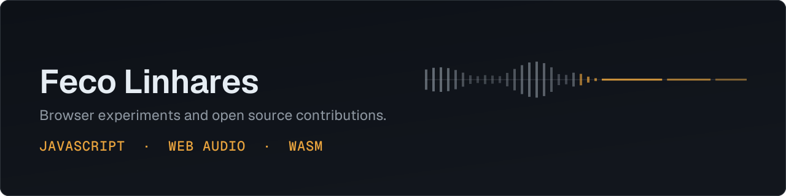

I spend most of my free time in the browser (or gaming), and most of it goes into experiments: browser games, audio tools that analyze your files without ever uploading them, etc. All of it is client-side: no framework, no server in the middle.

The rest goes back upstream, into the open source software I use every day. That is where the hermes-agent and other work below come from.

## Open in your browser

- **[BPMfinder](https://fecolinhares.github.io/BPMfinder/)**: instant tempo detection on essentia.js WASM. Your audio file stays on your machine. [Source](https://github.com/fecolinhares/BPMfinder).
- **[ChordsFinder](https://fecolinhares.github.io/ChordsFinder/)**: chord and key detection for any track you drop in, computed locally in the browser. [Source](https://github.com/fecolinhares/ChordsFinder).
- **[match-3djs](https://fecolinhares.github.io/match-3djs/)**: match-3 puzzle on Three.js, with a lo-fi soundtrack composed in code and controls for mouse, keyboard and touch. [Source](https://github.com/fecolinhares/match-3djs).
- **[super-kart-3djs](https://fecolinhares.github.io/super-kart-3djs/)**: cartoon kart racer with drift, items, turbo pads and AI rivals. Every texture and sound is generated at runtime, with zero external assets. [Source](https://github.com/fecolinhares/super-kart-3djs).

## Contributing upstream

- [NousResearch/hermes-agent](https://github.com/NousResearch/hermes-agent/pull/120769): contributed the opt-in session mirror behind the gateway Kanban board.
- [tester-army/e2e](https://github.com/tester-army/e2e): end-to-end test work on the suite.

---

Elsewhere: [@fecolinhares](https://x.com/fecolinhares)
